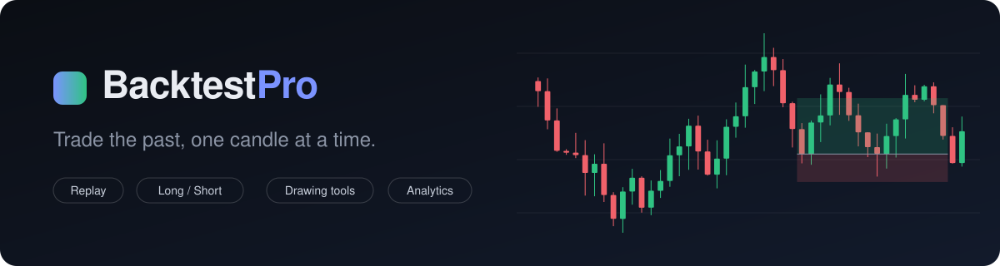

<p align="center">
  
</p>

<p align="center">
  <b>A full-stack trading replay and backtesting platform.</b><br>
  Replay the market candle by candle, trade long and short, draw on the chart, and review your results.
</p>

<p align="center">
  
  
  
  
  
</p>

---

## ✨ Features

| | |
|---|---|
| **Replay engine** | Candle-by-candle replay at 1x, 2x, 4x, 5x. Timeframes 1m, 5m, 15m, 1h, 1D, 1W. Pick any start date from year / month / day dropdowns. Scroll left to load older history on any timeframe. No look-ahead: higher timeframes show the still-forming candle. |
| **Realistic orders** | Size by **lots** (MT5 style), **% of balance** or **margin $**. Real leverage, bid/ask spread, gap-aware stop and target fills, margin level and stop-out. |
| **Position box** | Long / Short box with draggable **stop loss** and **take profit**, showing the profit or loss at each level, R:R and open P&L. |
| **Risk calculator** | Lots to trade for a chosen risk % and stop distance, with margin and reward. |
| **Drawing tools** | Trend line, ray, extended line, horizontal / vertical / cross lines, arrow, channel, rectangle, ellipse, triangle, brush, fib retracement and extension, measure, text, eraser, long / short planner. Click A, click B. Pin favourites to a draggable bar. |
| **Indicators** | SMA, EMA, Bollinger Bands, RSI, from a dropdown. |
| **Chart customisation** | Background, grid, candle colours, volume, borders, magnet crosshair. Right-click the chart for settings. |
| **Profiles** | Separate balance, leverage and trade history per strategy. |
| **Performance dashboard** | Net P&L, win rate, win/loss ratio, profit factor, expectancy, drawdown, streaks, equity curve, long vs short and by-symbol breakdowns, and a **P&L calendar** (year, month, week, day). |
| **Downloads** | Trades (CSV / JSON), performance summary, daily P&L, full report, and a complete export of your account data. |
| **Security** | Hashed passwords, httpOnly session cookies, CSRF checks, rate limiting, strict CSP, encrypted-at-rest database. See [Security](#-security). |

<!--
Add screenshots to docs/screenshots/ and uncomment:

<p align="center">
  
  
</p>
-->

## 🚀 Quick start

```bash
git clone https://github.com/Tech-Toki/backtest-pro.git
cd backtest-pro
npm install
cp .env.example .env        # Windows: copy .env.example .env
npm start                   # http://localhost:3000
```

Create an account on the login page and open the terminal. Without market data the app runs on **simulated candles** and shows a "Simulated data" badge.

> **Windows PowerShell blocks `npm`?** Run `Set-ExecutionPolicy -Scope CurrentUser -ExecutionPolicy RemoteSigned`, or use `npm.cmd install` / `npm.cmd start`.

### Using your own market data
Market data is **not included** in this repository (providers' terms usually forbid redistribution).
Put one-minute candles in `data/market/<SYMBOL>.csv`:

```csv
time,open,high,low,close,volume
1735689600,2625.10,2625.90,2624.80,2625.50,41
```

`time` is Unix seconds (UTC). Files for `BTCUSD` and `XAUUSD` are picked up on start-up (the first load builds a fast binary cache).
`npm run fetch:data` can download history for **personal practice**; check each provider's terms before using data any other way.

## 🧠 How the simulation works

- Candles are **bid** prices; **ask = bid + spread** (set per symbol in `server/config/symbols.js`). Longs open at ask and close at bid; shorts the reverse.
- Position value = lots × contract size × price. Margin = value ÷ leverage. `% Balance` and `Margin $` modes commit that much margin, so value = margin × leverage.
- Below a 50% margin level the biggest losing trade is closed (stop-out).
- A candle that gaps through your stop or target fills at its open. If both are inside one candle, the stop wins.
- Weekly candles start Monday 00:00 UTC; daily candles are UTC days.

## 🔐 Security

- **Passwords:** bcrypt (cost 12) over a SHA-256 pre-hash, 10+ characters, common passwords refused, timing-equalised login, 15-minute lock after 5 failed attempts.
- **Sessions:** httpOnly, `SameSite=Strict` cookie (`Secure` in production). Changing the password or *Sign out everywhere* revokes every session.
- **CSRF:** SameSite plus a required header and same-origin check on every write.
- **Headers:** strict Content-Security-Policy (no inline scripts, no third-party hosts), `no-referrer`, `nosniff`, `frame-ancestors 'none'`, HSTS in production. The chart library is served locally.
- **Rate limits** on the API, sign-in / registration and sensitive actions.
- **At rest:** `data/db.json` is AES-256-GCM encrypted. Only name, email and password hash are stored.
- **Your data, your call:** download everything or delete the account from *Manage account*.

<details>
<summary><b>Deploying it?</b></summary>

Set `NODE_ENV=production`, `JWT_SECRET`, `DATA_KEY` (both required in production), `TRUST_PROXY=1` behind a proxy, and serve over HTTPS.
Back up `data/.data-key`: without it the database cannot be decrypted. Generate secrets with:

```bash
node -e "console.log(require('crypto').randomBytes(48).toString('hex'))"
```
Not implemented: email verification, password reset, two-factor login.
</details>

## 🗂 Project structure

```
backtest-pro/
├── server/
│   ├── index.js              Express app, headers, rate limits
│   ├── db.js                 Encrypted JSON store
│   ├── config/symbols.js     Contract size, lot step, spread, decimals
│   ├── middleware/auth.js    Cookie sessions + CSRF guard
│   ├── security/             Key handling, password hashing
│   ├── routes/               auth, profiles, candles, trades
│   └── services/             market data, CSV loader, simulated fallback
├── scripts/
│   ├── fetch-data.js         Optional data downloader (personal use)
│   └── check-publish.js      Scans for secrets before you push
├── public/
│   ├── index.html  auth.html  terminal.html  performance.html
│   ├── css/                  base (design system), per-page styles
│   ├── vendor/               Lightweight Charts (local copy)
│   └── js/
│       ├── core/             api, theme, formatting
│       ├── trading/          engine, sizing, risk, replay, profiles
│       ├── chart/            chart view, overlay, drawings, position tool, indicators
│       ├── analytics/        stats, calendar, trade table, exports
│       ├── ui/               toolbar, panels, dialogs, toasts, motion
│       └── pages/            page entry points (wiring only)
└── docs/                     banner and screenshots
```

**Extending it**
- New drawing tool: add it in `chart/drawings.js` and an icon in `ui/toolbar.js`.
- New indicator: add it to `DEFS` and `INDICATORS` in `chart/indicators.js`.
- New symbol: `server/config/symbols.js`, the symbol dropdowns, and a CSV.
- Fees or slippage: `trading/engine.js`.

## 🛣 Roadmap
- [ ] Pending limit / stop orders
- [ ] Fees and slippage
- [ ] More indicators and drawing tools
- [ ] Strategy scripting and automated backtests
- [ ] SQLite / Postgres storage
- [ ] Email verification, password reset, two-factor login

## ⚠️ Disclaimer
Backtest Pro is an educational simulator. Past performance does not predict future results and nothing here is financial advice.

## 🙏 Credits
Charts use [TradingView Lightweight Charts](https://www.tradingview.com/) (Apache-2.0), bundled in `public/vendor`. This project is not affiliated with or endorsed by TradingView.

## 📄 License
[MIT](LICENSE) © Tech-Toki

---

<p align="center">Built by <a href="https://github.com/Tech-Toki"><b>Tech-Toki</b></a></p>
